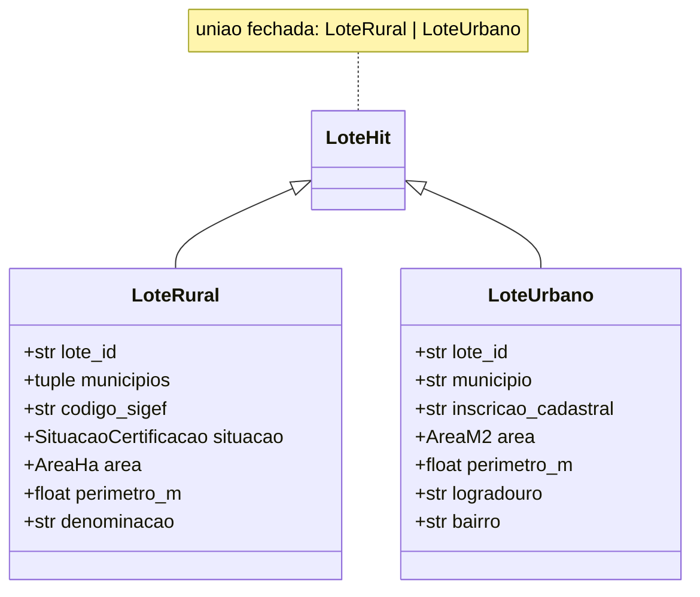
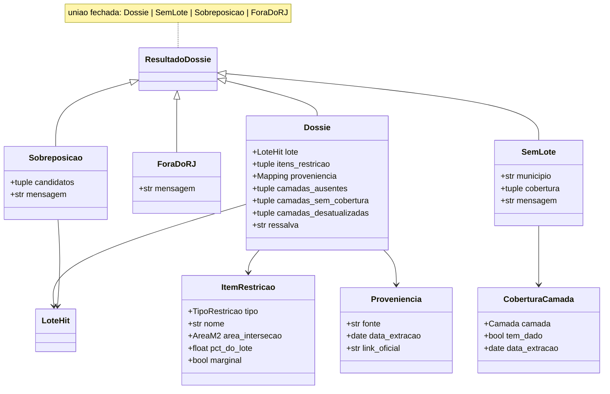
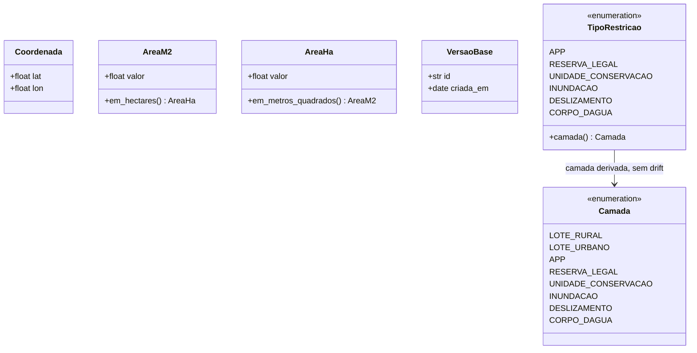
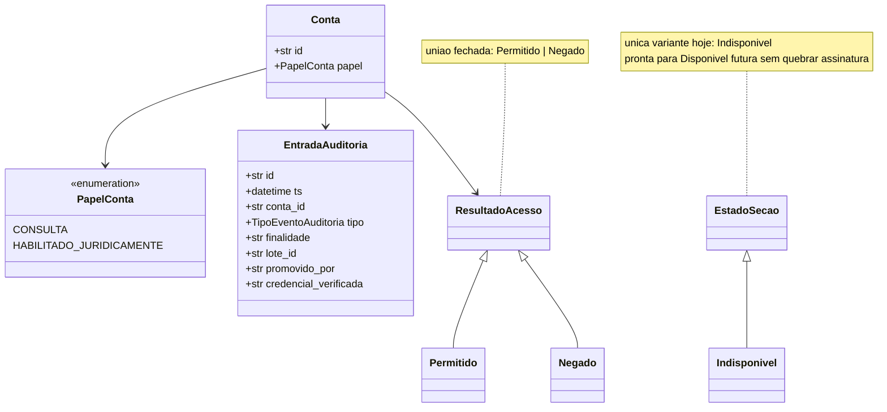

# Modelo de domínio — estado atual

Este documento é o mapa visual de `src/terrametrica/dominio/modelos.py`, o hub do vocabulário ubíquo
do projeto. A definição de cada termo em linguagem de produto (SIGEF, CAR, APP, testada...) está no
[glossário](produto/glossario.md). Este arquivo mostra a **forma** dos tipos. Ele não redefine o
vocabulário.

Dois princípios de `AGENTS.md` moldam tudo abaixo:

- **Tornar estados ilegais irrepresentáveis** — conjuntos fechados (enum/união), não string/bool
  livres.
- **Validar no boundary** — os construtores (`__post_init__`) rejeitam dado inválido na borda. O
  código interno confia no tipo.

---

## Identidade do lote — união fechada

`LoteRural` guarda a área em **hectares** (unidade do imóvel rural). `LoteUrbano` guarda a área em
**m²** (unidade do lote urbano). A montagem do dossiê normaliza para m² internamente
(`_area_do_lote_m2`), só para comparar com a área da interseção. Ela nunca converte a área exibida ao
usuário. Essa área mantém a unidade natural de cada tipo.

NOTE: Este documento descreve o snapshot da Fatia 2, como `docs/arquitetura.md`. Na época, `LoteUrbano`
existia no domínio sem linha de ingestão nem tabela Postgres.

---

## Resultado da montagem — união fechada de 4 casos

`ResultadoDossie = Dossie | SemLote | Sobreposicao | ForaDoRJ` é o tipo de retorno de
`montar_dossie`. A árvore de decisão completa está em `docs/arquitetura.md`. A união fechada impede,
no type-check (`mypy strict`), que o código que consome o dossiê esqueça um dos quatro casos.

Dentro de `Dossie`, o código trata três casos como diferentes. Eles não são sinônimos de "sem dado":

| Campo | Significa |
| --- | --- |
| `camadas_sem_cobertura` | O município não tem essa camada mapeada (fato estrutural, DOS-11) |
| `camadas_ausentes` | A camada existe no produto, mas esta versão não tem carimbo de proveniência (DOS-12) |
| `camadas_desatualizadas` | Tem proveniência, mas a extração passou de 90 dias (DOS-13) |

Nenhum dos três aparece como "vazio" ambíguo (AD-005: proveniência é requisito, não enfeite).

---

## Value objects e enums de suporte

`Coordenada` valida a faixa global de lat/lon no `__post_init__`. A contenção no RJ (DOS-05) é
responsabilidade do `Protocol` `LimiteEstado`, não deste value object. Assim o produto pode federar
outras UFs no futuro sem reescrever `Coordenada`. `AreaM2`/`AreaHa` rejeitam valor negativo e se
convertem entre si. Mas eles **nunca se misturam sem conversão explícita**. Não há um tipo `Area`
genérico que esconda a unidade.

`TipoRestricao.camada` é uma property, não um campo duplicado. A camada de origem de uma restrição
sempre sai do próprio tipo. Por isso as duas listas nunca divergem por esquecimento.

---

## Gate jurídico (P2) — sem dado pessoal

O detalhe estrutural que carrega a decisão de produto (AD-002): **`Conta` não tem nenhum campo que
guarde nome, CPF ou CNPJ de proprietário.** A ausência de dado pessoal é uma garantia de tipo. Não é
uma regra validada em runtime que alguém pode esquecer de checar. Para adicionar esse dado, é
preciso mudar a classe.

---

## Onde o vocabulário vira comportamento

O domínio (`dominio/modelos.py`) não faz I/O nem contém regra de decisão. Ele guarda só a forma dos
dados. As regras que operam sobre essa forma vivem em módulos separados:

| Módulo | O que decide |
| --- | --- |
| `dossie/montagem.py` | A árvore de 4 ramos que produz `ResultadoDossie` |
| `geometria/regras.py` | `classificar_intersecao` (marginal < 1%) e `avaliar_divergencia` (SIGEF × CAR, alerta > 5%) |
| `autorizacao/regras.py` | `avaliar_acesso_registral` e `estado_secao_proprietario` |

A ligação desses módulos aos *ports* e adapters está em `docs/arquitetura.md`.
